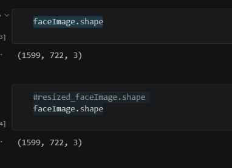
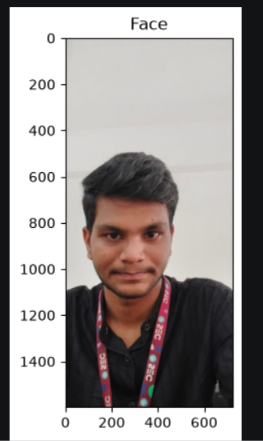
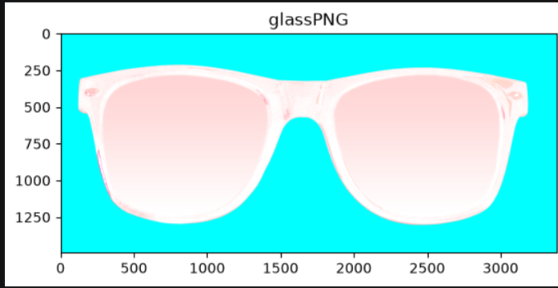
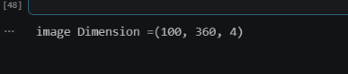
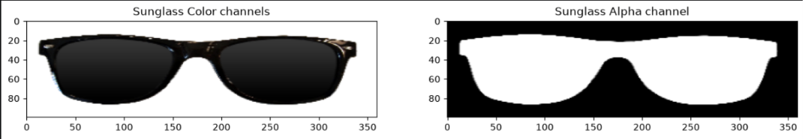
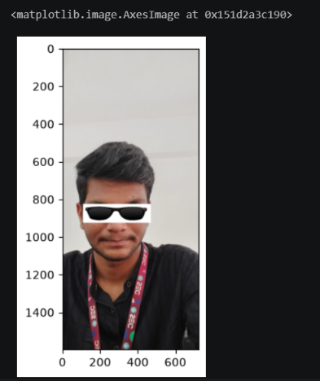
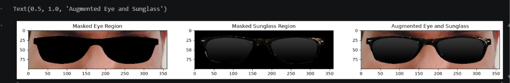
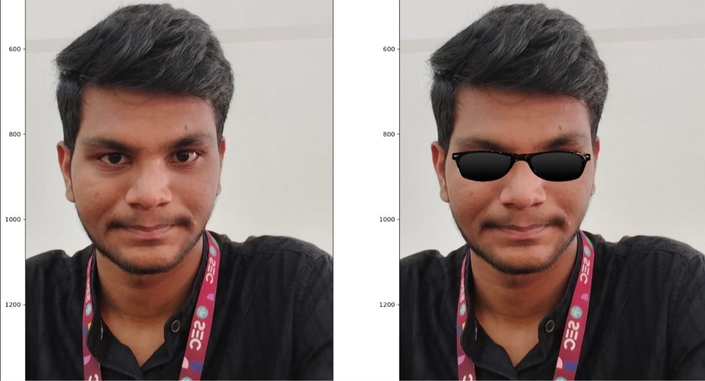

# DIGITAL_IMAGE_PROCESSING_TECHNIQUES-WS1
# Sturdy-Octo-Disco-Adding-Sunglasses-for-a-Cool-New-Look

Sturdy Octo Disco is a fun project that adds sunglasses to photos using image processing.

Welcome to Sturdy Octo Disco, a fun and creative project designed to overlay sunglasses on individual passport photos! This repository demonstrates how to use image processing techniques to create a playful transformation, making ordinary photos look extraordinary. Whether you're a beginner exploring computer vision or just looking for a quirky project to try, this is for you!

## Features:
- Detects the face in an image.
- Places a stylish sunglass overlay perfectly on the face.
- Works seamlessly with individual passport-size photos.
- Customizable for different sunglasses styles or photo types.

## Technologies Used:
- Python
- OpenCV for image processing
- Numpy for array manipulations

## How to Use:
1. Clone this repository.
2. Add your passport-sized photo to the `images` folder.
3. Run the script to see your "cool" transformation!
## PROGRAM:
### CODE FOR IMPORTING:
~~~
import cv2
import numpy as np
import matplotlib.pyplot as plt
~~~
### CODE:
~~~
# Load the Face Image
faceImage = cv2.imread(r"C:\Users\acer\Downloads\dip_ex-pareesh.jpeg")
plt.imshow(faceImage[:,:,::-1]);plt.title("Face")
~~~
## OUTPUT:

### CODE:
~~~
faceImage.shape
#resized_faceImage.shape
faceImage.shape
~~~
## OUTPUT:

### CODE:
~~~
# Load the Sunglass image with Alpha channel
# (http://pluspng.com/sunglass-png-1104.html)
glassPNG = cv2.imread(r"C:\Users\acer\Downloads\sunglass-png-aviator-sunglass-png-clipart-3381.png",-1)
plt.imshow(glassPNG[:,:,::-1]);plt.title("glassPNG")
~~~
## OUTPUT:

### CODE:
~~~
# Resize the image to fit over the eye region
glassPNG = cv2.resize(glassPNG,(360,100))
print("image Dimension ={}".format(glassPNG.shape))
~~~
## OUTPUT:

### CODE:
~~~
# Separate the Color and alpha channels
glassBGR = glassPNG[:,:,0:3]
glassMask1 = glassPNG[:,:,3]
----
# Display the images for clarity
plt.figure(figsize=[15,15])
plt.subplot(121);plt.imshow(glassBGR[:,:,::-1]);plt.title('Sunglass Color channels');
plt.subplot(122);plt.imshow(glassMask1,cmap='gray');plt.title('Sunglass Alpha channel');
~~~
## OUTPUT:

### CODE:
~~~
# Make a copy
#faceWithGlassesNaive = resized_faceImage.copy()
faceWithGlassesNaive = faceImage.copy()

# Replace the eye region with the sunglass image
faceWithGlassesNaive[825:925,110:470]=glassBGR

plt.imshow(faceWithGlassesNaive[...,::-1])
~~~
## OUTPUT:

### CODE:
~~~
# Make the dimensions of the mask same as the input image.
# Since Face Image is a 3-channel image, we create a 3 channel image for the mask
glassMask = cv2.merge((glassMask1,glassMask1,glassMask1))

# Make the values [0,1] since we are using arithmetic operations
glassMask = np.uint8(glassMask/255)

# Make a copy
faceWithGlassesArithmetic = faceImage.copy()

# Get the eye region from the face image
eyeROI= faceWithGlassesArithmetic[825:925,110:470]

# Use the mask to create the masked eye region
maskedEye = cv2.multiply(eyeROI,(1-  glassMask ))

# Use the mask to create the masked sunglass region
maskedGlass = cv2.multiply(glassBGR,glassMask)

# Combine the Sunglass in the Eye Region to get the augmented image
eyeRoiFinal = cv2.add(maskedEye, maskedGlass)

# Display the intermediate results
plt.figure(figsize=[20,20])
plt.subplot(131);plt.imshow(maskedEye[...,::-1]);plt.title("Masked Eye Region")
plt.subplot(132);plt.imshow(maskedGlass[...,::-1]);plt.title("Masked Sunglass Region")
plt.subplot(133);plt.imshow(eyeRoiFinal[...,::-1]);plt.title("Augmented Eye and Sunglass")
~~~
## OUTPUT:

### CODE:
~~~
# Replace the eye ROI with the output from the previous section
faceWithGlassesArithmetic[825:925,110:470]=eyeRoiFinal

# Display the final result
plt.figure(figsize=[20,20]);
plt.subplot(121);plt.imshow(faceImage[:,:,::-1]); plt.title("Original Image");
plt.subplot(122);plt.imshow(faceWithGlassesArithmetic[:,:,::-1]);plt.title("With Sunglasses");
~~~
## OUTPUT:

## Applications:
- Learning basic image processing techniques.
- Adding flair to your photos for fun.
- Practicing computer vision workflows.

Feel free to fork, contribute, or customize this project for your creative needs!